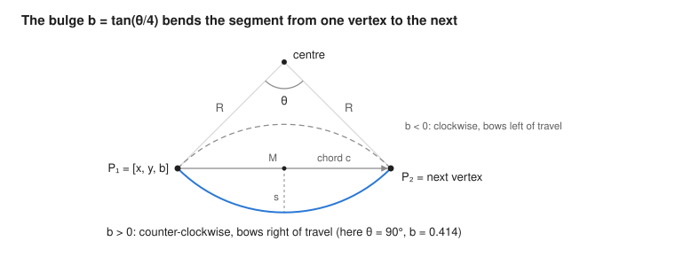

# Input JSON: loops, lines and circular arcs

How to write the JSON file that describes a shape for wfmat 2.x, and in particular how circular
arcs are described. The normative definition is [IN-01] and [IN-02] in [spec.md](spec.md); the
C++ side is in [api.md](api.md).

## Overview

A wfmat input file is one JSON object with two keys: `units`, a label for the length unit, and
`loops`, a list of closed boundary loops. Each loop is a list of vertices, and each vertex says
where a segment starts and whether that segment is straight or a circular arc.

```json
{
  "units": "mm",
  "loops": [
    [[0, 0], [100, 0], [100, 40], [0, 40]]
  ]
}
```

| Key | Required | Meaning |
| --- | --- | --- |
| `units` | no | Any string, e.g. `"mm"`. It is only a label copied to the outputs; numbers are never converted. |
| `loops` | yes | An array of one or more loops. Each loop is an array of vertices. |

Any other key is rejected with `unknown key`. Comments are not allowed in JSON.

## Vertices and segments

Each vertex starts one segment, and that segment ends at the next vertex. The last vertex's
segment closes the loop by running back to the first vertex, so never repeat the first point at
the end.

| Vertex form | Segment that starts here |
| --- | --- |
| `[x, y]` | Straight line to the next vertex |
| `[x, y, 0]` | Same: a bulge of 0 is a straight line |
| `[x, y, b]` with b ≠ 0 | Circular arc to the next vertex, shaped by the bulge `b` |

A loop of n vertices has exactly n segments. In the loop below, vertex 3 `[0, 40]` starts the
closing line from (0, 40) back to (0, 0):

```json
[[0, 0], [100, 0], [100, 40], [0, 40]]
```

The bulge belongs to the segment **after** a vertex, not before it. To make the top edge of that
rectangle an arc, put the bulge on `[100, 40]`, the vertex where the top edge starts.

Coordinates and bulges are plain JSON numbers. Write them with as many digits as you have; the
reader keeps full double precision.

## Circular arcs and the bulge

An arc is described by one number, the bulge b = tan(θ / 4), where θ is the arc's signed sweep
angle. The start and end points come from the two vertices; the bulge fixes how far the arc bows
away from the straight chord between them. This is the same convention as DXF LWPOLYLINE.



The arrow on the chord is the direction of travel, from the vertex that carries the bulge to the
next one. Flipping the sign of b mirrors the arc across the chord.

### Sign: which way the arc turns

- **b > 0**: the arc runs counter-clockwise from start to end and bows out to the **right** of the
  direction of travel.
- **b < 0**: the arc runs clockwise and bows out to the **left** of the direction of travel.
- **|b| = 1** is a half circle; |b| < 1 is less than a half circle; |b| > 1 is more than a half
  circle.

Every valid loop keeps the material on its left. So in any loop, outer or hole, a **positive**
bulge bows the edge **away from** the material and a **negative** bulge bows it **into** the
material. On the counter-clockwise outer loop, b > 0 gives a rounded tab or a convex fillet and
b < 0 gives a notch. A round hole's edge bows into the surrounding plate, which is why it is
written with b = −1.

### Common sweep angles

| Sweep θ | Bulge b (counter-clockwise) | Bulge b (clockwise) |
| --- | --- | --- |
| 30° | 0.131652497587 | −0.131652497587 |
| 45° | 0.198912367380 | −0.198912367380 |
| 60° | 0.267949192431 | −0.267949192431 |
| 90° (quarter circle, fillet) | 0.414213562373 | −0.414213562373 |
| 120° | 0.577350269190 | −0.577350269190 |
| 180° (half circle) | 1 | −1 |
| 270° | 2.414213562373 | −2.414213562373 |

The sweep must be strictly between 0 and 360°, so a full circle cannot be one segment. Write it as
two half circles: two vertices, each with b = 1 (or −1 for a hole).

### From a bulge to the circle

With chord length c = |P₂ − P₁| between the start P₁ and end P₂:

```math
\theta = 4\arctan b, \qquad R = \frac{c\,(1 + b^2)}{4\,|b|}, \qquad s = \frac{|b|\,c}{2}
```

R is the radius and s the sagitta, the height of the arc above the chord's midpoint M. The centre
lies on the perpendicular through M, at a signed distance of (c/2)(1 − b²)/(2b) to the left of the
chord's direction. For a half circle (|b| = 1) the centre is M itself.

### From a circle to a bulge

If you know the arc as a centre C, radius R, start angle α and signed sweep θ (counter-clockwise
positive):

1. Start vertex: P₁ = C + R (cos α, sin α). Give this vertex the bulge b = tan(θ / 4).
2. End point: P₂ = C + R (cos(α + θ), sin(α + θ)). This is the next vertex in the loop.

Example: a 90° fillet of radius 10 rounding the top-right corner of a 100 × 40 rectangle has
centre (90, 30). Going counter-clockwise it starts at (100, 30) with α = 0° and θ = +90°, ends at
(90, 40), and gets b = tan(22.5°) = 0.414213562373.

If you know the radius instead of the sweep, solve for b from the chord:
|b| = (2R − √(4R² − c²)) / c for the short arc (under 180°), and
|b| = (2R + √(4R² − c²)) / c for the long arc; then pick the sign from the direction. From C++ you
can skip the arithmetic: `wfmat::loop_from_segments` accepts
`ArcSpec{centre, radius, start_angle, sweep}` (angles in radians) and converts it for you.

## Loops, holes and islands

A shape with holes is just more loops in the `loops` array, in any order. wfmat works out which
loop is inside which; you only have to give each loop the right direction for its depth.

| Depth | What it is | Direction | Round version |
| --- | --- | --- | --- |
| 0 | Outer outline | Counter-clockwise | b = +1 on both vertices |
| 1 | Hole in the outline | Clockwise | b = −1 on both vertices |
| 2 | Island inside a hole | Counter-clockwise | b = +1 |
| 3 | Hole in an island | Clockwise | b = −1 |

Depths go up to 7 (8 levels). Each counter-clockwise loop together with the holes directly inside
it is one *component*, and the outputs are grouped by component.

The program checks these rules and reports a violation; it never repairs the input:

- Every segment is longer than a small tolerance, and every arc sweeps more than a tiny angle and
  less than 360°.
- A loop does not cross or touch itself.
- Loops do not cross or touch each other, so a hole may not share an edge or a point with the
  outline.
- No cusps: two segments may not meet folded back on each other.
- Each loop runs in the direction for its depth. Version 1 silently reversed a clockwise outline;
  version 2 rejects it.

A quick way to check a direction: walk along the loop in vertex order. If the material is on your
left, the direction is right.

## Worked examples

Each example below is a complete file and was run through `wfmat-cli` 2.0.0. The area it reported
is listed so you can check your own conversions.

**1. Circle, radius 10, centre (0, 0).** Two half circles, counter-clockwise. Area 314.159 mm².

```json
{"units": "mm", "loops": [[[10, 0, 1], [-10, 0, 1]]]}
```

**2. Rectangle with one rounded corner.** A 100 × 40 rectangle, the top-right corner replaced by a
90° fillet of radius 10. The arc starts at (100, 30), so that vertex carries b = tan(22.5°).
Area 3978.540 mm².

```json
{"units": "mm", "loops": [[[0, 0], [100, 0], [100, 30, 0.41421356237309503], [90, 40], [0, 40]]]}
```

**3. Slot.** An 80 mm straight section with a half circle of radius 10 at each end. Both arcs are
positive: on the outline they bow away from the material. Area 1914.159 mm².

```json
{"units": "mm", "loops": [[[0, 0], [80, 0, 1], [80, 20], [0, 20, 1]]]}
```

**4. Semicircular notch.** The rectangle's top edge, travelled from right to left, has a notch of
radius 10 cut into it between x = 60 and x = 40. The arc bows into the material, so b = −1.
Area 3842.920 mm².

```json
{"units": "mm", "loops": [[[0, 0], [100, 0], [100, 40], [60, 40, -1], [40, 40], [0, 40]]]}
```

**5. Arc longer than a half circle.** A 270° arc from (0, 0) to (20, 0), closed by the straight
chord. b = tan(67.5°) gives R = 14.142 and centre (10, −10). Area 571.239 mm².

```json
{"units": "mm", "loops": [[[0, 0, 2.414213562373095], [20, 0]]]}
```

**6. Plate with holes and an island** (`tests/data/plate-with-holes.json`). A 100 × 40 plate with
a half-circle tab of radius 20 on top; a round hole of radius 5; a 15 × 20 rectangular hole; and a
round island of radius 1 inside that rectangular hole. Area 4252.920 mm²: 4628.3 for the plate and
tab, minus 78.5 and 300 for the holes, plus 3.1 for the island.

```json
{"units": "mm",
 "loops": [
  [[0, 0, 0], [100, 0, 0], [100, 40, 1], [60, 40, 0], [0, 40, 0]],
  [[15, 20, -1], [25, 20, -1]],
  [[40, 10], [40, 30], [55, 30], [55, 10]],
  [[47, 15, 1], [49, 15, 1]]
 ]}
```

Loop 0 is the outline (counter-clockwise). Loops 1 and 2 are holes (clockwise: the round hole with
negative bulges, and the rectangle going up the left side first). Loop 3 is an island inside
loop 2, so it is counter-clockwise again.

## Running it and common mistakes

Save the file, for example as `my-part.json`, and run it (Windows build paths as in
[building-windows.md](building-windows.md)):

```powershell
.\build\vs2026\Release\wfmat-cli.exe my-part.json --svg out\my-part.svg --offset 2
```

The first line says `valid` and gives the loop, line and arc counts. Check them and the reported
area against what you meant to draw. Then open the SVG in a browser to see the outline, the medial
axis and the offset.

The messages below are what wfmat 2.0.0 prints for each mistake. Loops and segments are numbered
from 0.

| Mistake | Message |
| --- | --- |
| First point repeated at the end | `IN-03: … segment 4 is shorter than the minimum length` |
| Outline drawn clockwise | `IN-08: loop 0 at depth 0 must run counter-clockwise` |
| Hole drawn counter-clockwise (e.g. b = +1 on a round hole) | `IN-08: loop 1 at depth 1 must run clockwise` |
| A loop with only one vertex | `IN-03: loop 0: a loop needs at least two vertices` |
| Two vertices joined by straight lines only | `IN-06: … cusp at vertex 1` |
| Edges cross (vertices in the wrong order) | `IN-04: the loop is not simple: segments 1 and 3 intersect` |
| Hole touching the outline | `IN-12: loops 0 and 1 meet: …` |
| A vertex with one or four numbers | `IN-02: … vertex 1 must be [x, y] or [x, y, bulge]` |
| Both `loops` and `outer` in one file | `IN-02: use either "loops" or "outer" with "holes", not both` |

Files written for version 1 still work. They use `"outer"` for the outline and an optional
`"holes"` list, with the same vertex and bulge rules:

```json
{"units": "mm", "outer": [[0, 0], [100, 0], [100, 40], [0, 40]], "holes": [[[15, 20, -1], [25, 20, -1]]]}
```

The outline is loop 0 and the holes follow in order. Files that wfmat writes always use `"loops"`.
